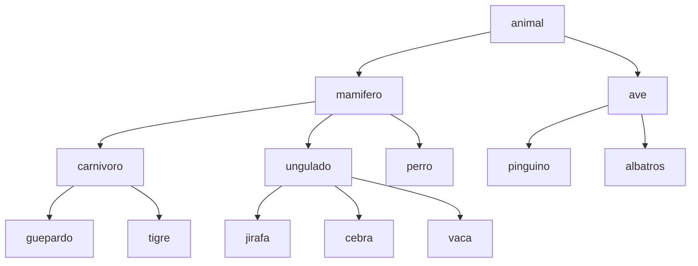
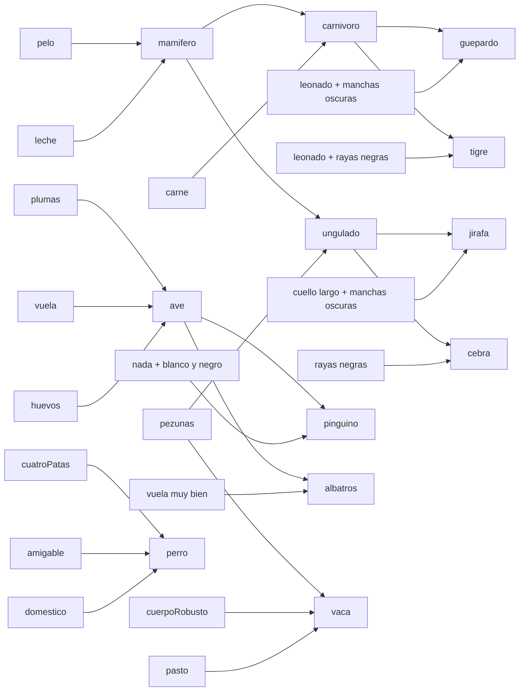
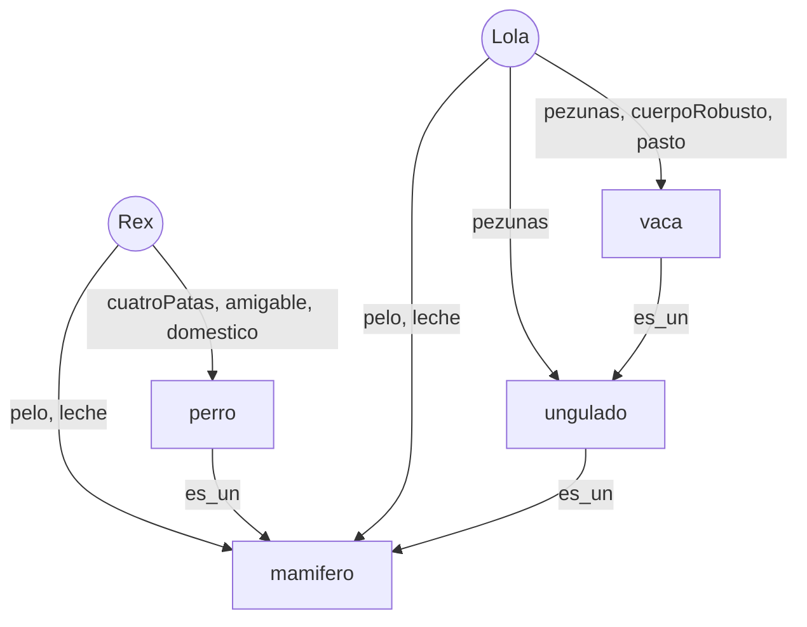

# Ontologia
## 1. Jerarquía de clases 

## 2. Reglas

## 3. Individuos 

## 4. Tabla de reglas

| # | Si | Entonces |
|---|----|----------|
| 1 | animal tiene pelo | mamífero |
| 2 | animal da leche a sus crías | mamífero |
| 3 | animal tiene plumas | ave |
| 4 | vuela y pone huevos | ave |
| 5 | mamífero come carne | carnívoro |
| 6 | mamífero tiene pezuñas | ungulado |
| 7 | carnívoro leonado con manchas oscuras | guepardo |
| 8 | carnívoro leonado con rayas negras* | tigre |
| 9 | ungulado de cuello largo con manchas oscuras | jirafa |
| 10 | ungulado con rayas negras | cebra |
| 11 | ave que nada y es blanca y negra | pingüino |
| 12 | ave que vuela muy bien | albatros |
| 13–14 | pelo, cuatro patas, amigable (y doméstico) | perro |
| 15 | pelo y da leche | mamífero |
| 16 | mamífero con pezuñas y cuerpo robusto | vaca |
| 17 | cuatro patas, pezuñas y se alimenta de pasto | vaca |
